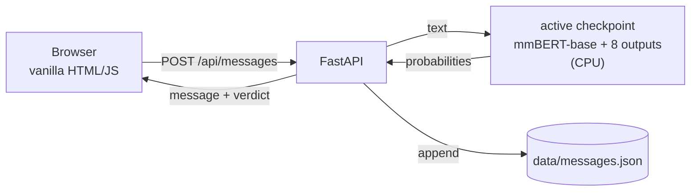
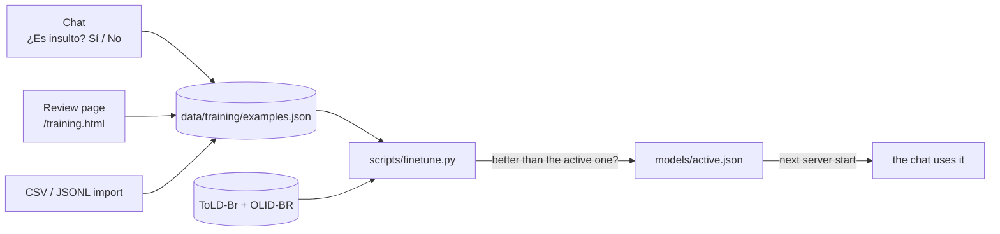

# Message flagger

A tiny chat that runs every message through a **fine-tuned [mmBERT-base](https://huggingface.co/jhu-clsp/mmBERT-base)** classifier to:

- **flag harmful messages** (insults, threats and identity hate): a flagged message is blurred like a spoiler, and hovering or tapping reveals it;
- **classify sentiment** as positive, negative or neutral;
- **count it all** in live tiles at the top.

You can **teach the model your own definition of an insult** by labeling examples and fine-tuning it on your GPU. The trained model runs on a CPU.

> The UI is in Spanish (Rioplatense) because that is the language it was built to moderate.

---

## The model

mmBERT-base is a 307M-parameter multilingual encoder (MIT). We add eight outputs and fine-tune it, so one forward pass returns:

| Output | Kind | Used for |
|---|---|---|
| `insult`, `threat`, `identity_hate` | independent probabilities | the flag: `max` of the three above the checkpoint's threshold |
| `sexual_harassment`, `profanity` | independent probabilities | shown, never flag on their own |
| `sentiment.positive/negative/neutral` | one distribution | the sentiment chip and the tiles |

On a 4-thread CPU it takes about 20 ms per message.

## How it works



- **One process.** FastAPI serves the API and the static frontend, and loads the active checkpoint (`models/active.json`) at startup.
- **Storage.** Plain JSON files under `data/`, written atomically.

## Quick start

You need Python 3.11–3.13 and [uv](https://docs.astral.sh/uv/). Training wants an NVIDIA GPU; serving runs on CPU.

```bash
uv sync
uv run python scripts/finetune.py                  # first time: trains and activates a checkpoint
uv run uvicorn app.main:app --port 8080
```

Open <http://127.0.0.1:8080>. The server refuses to start without an active checkpoint and says how to train one.

`torch` comes from PyTorch's CUDA 13.0 index (see `pyproject.toml`), because PyPI only has CPU builds for Windows.

| Variable | Default | What it does |
|---|---|---|
| `FLAG_THRESHOLD` | the checkpoint's | minimum flag score to blur a message |
| `MODEL_DEVICE` | `cpu` | torch device for the server (`cuda`, `cpu`) |

To try the model without the UI:

```bash
uv run python scripts/try_model.py "callate gil" "no sos un idiota" "te voy a romper la cara"
```

## Fine-tuning



**1. Label examples.** There are three ways, and they all land in the same dataset:

- in the chat, with the *¿Es insulto? Sí / No* buttons under every message;
- on the review page, one pending example at a time, with keyboard shortcuts `1` insult, `2` not an insult, `3` discard;
- by importing a file: `uv run python scripts/import_examples.py file.csv` (a `text` column and an optional `label` column with `insult` or `clean`).

`datasets/generated_rioplatense_v1.jsonl` has 421 generated Rioplatense examples, heavy on the hard cases: threats, negations, friendly *"boludo"*, sarcasm, swearing at no one.

**2. Train.**

```bash
uv run python scripts/finetune.py                  # trains, evaluates, activates only if better
uv run python scripts/finetune.py --seed 1 --no-activate
```

- **Data.** ToLD-Br and OLID-BR (Portuguese), with no text that the evaluation uses, plus your labeled Spanish examples, repeated 3×. A Spanish example that is also a suite row takes the suite's per-category labels; unknown labels are masked out of the loss.
- **Sentiment.** No permissively licensed Spanish or Portuguese sentiment corpus exists, so Qwen3-4B labels every training text once, offline, and the labels are cached in `data/training/sentiment_labels.jsonl`. Qwen only labels training data; the served model is mmBERT alone.
- **Threshold.** The flag threshold flags 5% of the Spanish calibration negatives and is saved with the checkpoint.
- **Evaluation.** The same exam as [Comparing checkpoints](#comparing-checkpoints), without the texts the checkpoint trained on.
- **Activation.** The new checkpoint replaces the active one only if its Spanish flag AUROC is higher and its Spanish sentiment macro-F1 drops by no more than 0.05. The first one activates if its Spanish AUROC is at least 0.75.
- **GPU heat.** The GPU works about 60% of the time (`DUTY=0.6`).

**3. Restart the server** to load the new checkpoint. To pick another one:

```bash
uv run python scripts/activate_model.py --list   # trained checkpoints, their Spanish AUROC and threshold (* = active)
uv run python scripts/activate_model.py models/ft-20261007-184309
```

The step-by-step guide, including the labeling policy and how to read the report, is in [`docs/finetuning.md`](docs/finetuning.md) (in Spanish).

## Comparing checkpoints

Every training run saves a new checkpoint in `models/ft-<date>/`, and none overwrites another. `bench/` measures them all with one exam: Spanish, Portuguese and English messages labeled for insult, threat, identity hate, sexual harassment and profanity.

```bash
uv run python scripts/bench.py sources                           # what the exam contains
uv run python scripts/bench.py run                               # every checkpoint → bench_out/scoreboard.md
uv run python scripts/bench.py run --checkpoints ft-20261007-184309,ft-20261008-120000
uv run python scripts/bench.py latency --device cpu --threads 4
```

- **Exam.** A Rioplatense casino suite the team reviews (`suites/es_casino.csv`), HateCheck in Spanish, Portuguese and English, and held-out ToLD-Br and OLID-BR rows.
- **Fair comparison.** The texts that any compared checkpoint trained on leave the exam for all of them.
- **Thresholds.** Each checkpoint gets one operating threshold, set on a calibration split at 5% false positives.
- **Report.** Per-source AUROC with bootstrap confidence intervals, paired comparisons against the best checkpoint, and per-functionality accuracy.
- **Cache.** Predictions are cached in `bench_out/predictions/` by checkpoint, so a rerun only scores what is new. The trainer writes there too.

The labeling policy, the review guide and how to read the report are in [`docs/benchmark.md`](docs/benchmark.md) (in Spanish).

## Data and licenses

Everything runs locally: no message is sent to an external API. Every Hugging Face dataset and model is pinned to a commit.

| Data | Language | Used for | License |
|---|---|---|---|
| [ToLD-Br](https://huggingface.co/datasets/mteb/told-br) | pt | training; a held-out sample for evaluation | CC BY-SA 4.0 |
| [OLID-BR](https://huggingface.co/datasets/dougtrajano/olid-br) | pt | training (`train` split); evaluation (`test` split) | CC BY 4.0 |
| [Multilingual HateCheck](https://huggingface.co/datasets/Paul/hatecheck-spanish) (es, pt) and [HateCheck](https://huggingface.co/datasets/Paul/hatecheck) (en) | es, pt, en | evaluation | CC BY 4.0 |
| [DynaSent](https://github.com/cgpotts/dynasent) round 2 test, in `data/sentiment/` | en | sentiment evaluation | CC BY 4.0 |
| Casino suite, `suites/es_casino.csv` | es | evaluation; its labels also refine matching training examples | own |
| Labeled examples, `data/training/examples.json` (seeded from `datasets/generated_rioplatense_v1.jsonl`) | es | training | own |
| Spanish sentiment draft, `data/sentiment/suite_sentiment_draft.csv` (unreviewed) | es | sentiment evaluation | own |

| Model | Role | License |
|---|---|---|
| [mmBERT-base](https://huggingface.co/jhu-clsp/mmBERT-base) | the base of every checkpoint; the only model the app serves | MIT |
| [Qwen3-4B-Instruct-2507](https://huggingface.co/Qwen/Qwen3-4B-Instruct-2507) | labels the sentiment of training texts, offline, on the GPU | Apache-2.0 |

Left out because of their licenses or access terms: OffendES, HatEval and HateBR for moderation, and TASS, InterTASS, TweetSentBR and BRIGHTER for sentiment.

## Project layout

```
app/
  main.py          FastAPI app: chat, labeling and training endpoints, static files
  classifier.py    the flag rule and the verdict for each message
  model.py         a checkpoint's outputs: names, sigmoid/softmax, batch prediction
  examples.py      labeled-example store, deterministic splits, CSV/JSONL parsing
  checkpoints.py   which fine-tuned checkpoint is active
  store.py         chat message store
trainer/
  finetune.py      training, saving, evaluation and activation
  data.py          the training set
  sentiment.py     the cache of offline sentiment labels
  labeler.py       Qwen3-4B, which drafts those labels
  evaluation.py    threshold, AUROC per source, sentiment F1
  metrics.py       the activation rule
  throttle.py      keeps the GPU from running flat out
bench/             the exam: sources, taxonomy, checkpoint comparison, metrics, report
suites/            the hand-written Spanish suite reviewers edit
scripts/           try_model · import_examples · finetune · activate_model · bench · seed_suite
static/            chat (index.html) and review page (training.html), no build step
datasets/          generated examples to review
tests/             pytest suite
```

## API

| Method | Path | |
|---|---|---|
| `GET` | `/api/messages` | chat history, with each message's label if any |
| `POST` | `/api/messages` | `{"text"}` → classify, store, return the message |
| `POST` | `/api/messages/{id}/label` | `{"label": "insult" \| "clean"}` |
| `GET` | `/api/stats` | counts for the tiles |
| `GET` | `/api/training/summary` | labeling progress and the model in use |
| `GET` | `/api/training/next` | next pending example, with the model's current flag score |
| `POST` | `/api/training/examples/{id}/label` | `{"label": "insult" \| "clean" \| "discard"}` |

A classified message looks like this (`"te voy a romper la cara"`, numbers rounded):

```json
{
  "flagged": true,
  "flag": {"score": 1.0, "category": "threat", "threshold": 0.71},
  "categories": {"insult": 0.54, "threat": 1.0, "identity_hate": 0.1, "sexual_harassment": 0.54, "profanity": 0.24},
  "sentiment": {"label": "negative", "confidence": 1.0, "probabilities": {"positive": 0.0, "negative": 1.0, "neutral": 0.0}},
  "model": "ft-20261007-184309",
  "latency_ms": 21
}
```

## Tests

```bash
uv run pytest            # fast suite, no model needed
uv run pytest -m slow    # real checkpoints and datasets: trains mmBERT-base for one epoch
```

## Known limitations

- **Data, not architecture.** Training had 93 threats and no sexual harassment, so those categories are weak: `sexual_harassment` is not meaningful yet. Reviewed examples of threats, identity hate, sexual harassment and obfuscated insults are what improves it.
- **Unreviewed numbers.** The Spanish suite is generated and not reviewed yet, and the Spanish sentiment labels (training and evaluation) are LLM drafts.
- **Negations.** *"no sos un idiota"* still gets flagged.
- **English.** Training data is Portuguese and Spanish; English works through mmBERT's multilingual pretraining only.
